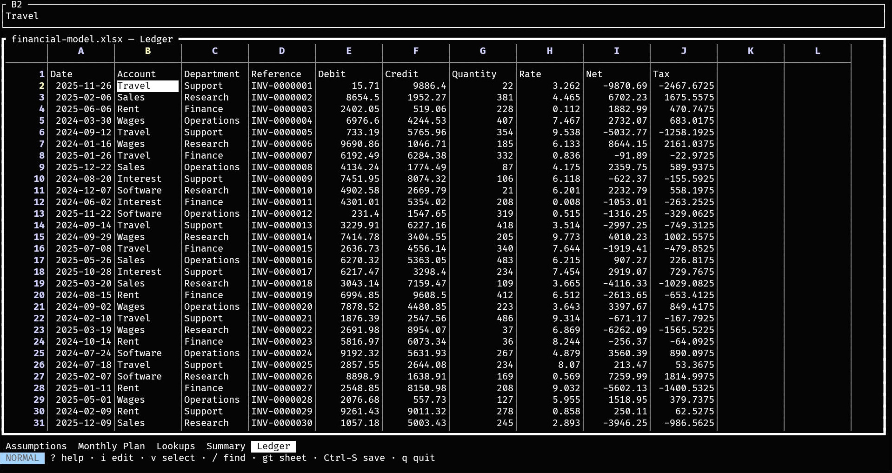

# TUICalc

[](https://crates.io/crates/tuicalc)
[](https://github.com/christianhelle/tuicalc/actions/workflows/ci.yml)
[](LICENSE)

View and edit Excel `.xlsx` and OpenDocument `.ods`, `.ots` and `.fods` workbooks from the terminal,
with vim-style keys. Saving changes only the cells you edited, so charts, styles, pivot tables and
macros survive, and large workbooks open and save in the background while you keep working.



## Install

tuicalc installs as the `tcalc` command, which is quicker to type.

### macOS/Linux

```bash
curl -fsSL https://christianhelle.com/tuicalc/install | bash
```

This installs the latest release to `~/.local/bin`. To install somewhere else, or to pin a release:

```bash
curl -fsSL https://christianhelle.com/tuicalc/install | INSTALL_DIR="$HOME/bin" bash
curl -fsSL https://christianhelle.com/tuicalc/install | VERSION="0.1.1" bash
```

### Windows PowerShell

```powershell
irm https://christianhelle.com/tuicalc/install.ps1 | iex
```

This installs the latest release to `%LOCALAPPDATA%\Programs\tuicalc`, or to `~\.local\bin` or `~\bin`
if one of those already exists, and adds it to your user `PATH`. To install somewhere else, or to pin
a release:

```powershell
$install = irm https://christianhelle.com/tuicalc/install.ps1
& ([scriptblock]::Create($install)) -InstallDir "$env:USERPROFILE\bin"
& ([scriptblock]::Create($install)) -Version "0.1.1"
```

### Cargo

With [Rust](https://rustup.rs) 1.89 or later, install it from
[crates.io](https://crates.io/crates/tuicalc):

```bash
cargo install tuicalc --locked
```

### Release archives

Download a build from the [releases page](https://github.com/christianhelle/tuicalc/releases), unpack
it and put `tcalc` somewhere on your `PATH`. Archives are available for Linux, macOS and Windows, on
x64 and ARM64.

To try changes that aren't released yet, install straight from GitHub:

```bash
cargo install --git https://github.com/christianhelle/tuicalc
```

## Usage

```
tcalc path/to/book.xlsx
tcalc path/to/book.ods
tcalc
```

With no file, `tcalc` opens a blank workbook. `Ctrl-O` opens another one from inside the app. A file's
format comes from what's in it, not from its name.

## Keys

tuicalc starts in normal mode and works like vim, on a grid of cells. Press `?` for the keys of the
current mode, or `F1` while editing a cell, and any key to close the list. The status line names the
current mode, and shows a command you haven't finished at its right edge.

### Normal mode

Most motions take a count, such as `5j` or `3w`. As with vim's hybrid line numbers, the cursor's
row shows its number and every other row shows how far it is from the cursor, so the count for `j`
or `k` can be read off the screen. A "word" is a run of filled cells in the row, and
a "paragraph" is a run of filled cells in the column.

| Key | Action |
| --- | --- |
| `h` `j` `k` `l`, arrows, `Tab`, `Shift-Tab`, `Enter` | Move |
| `w` `b` `e` | Next run, start of this or the previous run, end of this or the next run |
| `}` `{` | Next or previous gap in the column |
| `0` `^` `$` `{n}\|` | First column, first filled cell, last filled cell, column n |
| `gg` `G` `{n}G` | First row, last used row, row n |
| `H` `M` `L` | Top, middle or bottom of the screen |
| `Ctrl-D` `Ctrl-U` `Ctrl-F` `Ctrl-B` | Scroll half a page or a page, down or up |
| `zt` `zz` `zb` | Put the cursor's row at the top, middle or bottom of the screen |
| `gt` `gT` `{n}gt`, `F6`, `Shift-F6`, `Ctrl-PgDn`, `Ctrl-PgUp` | Next, previous or nth sheet |
| `PgUp` `PgDn` `Home` `End`, `Ctrl-Home` `Ctrl-End` | Move by page, to the row's edge, to A1 or the last used cell |
| `i` `a` `F2` | Edit the cell with the caret at the start or the end |
| `s` `=` | Replace the cell, or start a formula |
| `o` `O` | Edit the cell below or above |
| `x` `X` `D`, `Delete` | Clear cells at the cursor, to its left, or to the row's end |
| `d` `y` `c` + motion | Delete, yank or change the cells the motion covers, as in `d$`, `y3j` or `cw` |
| `dd` `yy` `cc` `S` `C` | The same for whole rows, and `C` to the row's end |
| `p` `P` | Paste, adjusting relative references in formulas |
| `u` `Ctrl-R`, `Ctrl-Z` `Ctrl-Y` | Undo, redo |
| `v` `Ctrl-V` `V` | Select cells or whole rows |
| `/` `n` `N` | Find text in this sheet, then the next or previous match, ignoring case |
| `Ctrl-G` | Go to a cell such as `C7`, or a row such as `25` |
| `Ctrl-S` | Save |
| `Ctrl-O` | Choose a workbook to open |
| `F5` | Reload the workbook from disk |
| `q` `Ctrl-Q` `Ctrl-C` | Quit |
| `ZZ` `ZQ` | Save and quit, quit without saving or asking |
| `?` `F1` | Show the keys |

### Insert mode

| Key | Action |
| --- | --- |
| `Esc` | Keep the text and stay on the cell |
| `Enter`, `Tab`, `Shift-Tab`, `Up`, `Down` | Keep the text and move |
| `Ctrl-C` | Drop the text |
| `F1` | Show the keys |
| `Left` `Right` `Home` `End` | Move the caret |
| `Backspace` `Delete` `Ctrl-W` `Ctrl-U` | Delete a character, the word before the caret, or everything before it |

### Visual modes

Every motion extends the selection.

| Key | Action |
| --- | --- |
| `d` `x` `Delete`, `y`, `c` `s` | Delete, yank or change the selection |
| `o` | Jump to the selection's other corner |
| `v` `V` | Switch between selecting cells and rows, or leave |
| `Esc` `Ctrl-C` | Leave |
| `?` `F1` | Show the keys |

### Unsaved changes

Quitting, opening another workbook or reloading with unsaved edits asks first, and says what happens
next. `ZQ` is the one way to lose edits without being asked.

| Key | Action |
| --- | --- |
| `s` | Save, then carry on |
| `d` | Discard the edits and carry on. When opening a workbook, they're kept until a file opens |
| Anything else | Stay, keeping the edits |

### Mouse

In normal mode, click a cell to move there, or a sheet's tab to show it. The wheel moves the cursor
three rows, and extends a selection in the visual modes. A click closes the keys list. Hold `Shift`
to select text in the terminal.

### File dialog

Opening a workbook, or saving a new one, opens a dialog. It lists folders and `.xlsx`, `.ods`, `.ots`
and `.fods` files, and adds `.xlsx` to a name with no extension. A new workbook is saved in the format
its name asks for. If it opened because you were quitting or opening another file,
that carries on once the save succeeds. Opening a file starts a new undo history, and what you yanked
can still be pasted.

| Key | Action |
| --- | --- |
| Typing, `Backspace` | Edit the name, which can also be a path |
| `Up` `Down` | Highlight a line, and a file's name fills in the name |
| `Enter` | Open the highlighted folder, or otherwise open or save the file, asking before overwriting one |
| `Esc` `Ctrl-C` | Close without opening or saving, keeping the edits |

### Large workbooks

A workbook appears as soon as it's opened, and its cells fill in behind the scenes, with the sheet
you're looking at first and progress on the status line. You can move around, search and switch
sheets straight away, and `Esc` stops opening. Until it finishes, `G` and `Ctrl-End` go to the last
cell so far, search covers what has loaded so far, and editing, copying and saving wait. If opening
another workbook or reloading stops or fails, you return to where you were, unsaved edits included.

An OpenDocument file keeps all its sheets in one stream, so tuicalc reads through it once to find their
names before showing it, and its cells then arrive in file order rather than the sheet you're looking
at first.

## Entering values

Numbers, `TRUE`/`FALSE` and error literals such as `#N/A` are recognised. A leading `=` makes a
formula, and a leading `'` forces text. Date-formatted cells show and accept `YYYY-MM-DD`,
`YYYY-MM-DD HH:MM:SS` and `HH:MM:SS`.

Formulas read the same in every format, as in `=SUM(A1:B2,Sheet2!C3)`. An OpenDocument file stores that
as `of:=SUM([.A1:.B2];[$Sheet2.C3])`, and tuicalc converts between the two. A reference it can't convert,
such as one to another file, shows as it's stored.

## How saving works

Saving patches the original package rather than regenerating it. Parts the edit doesn't touch are
copied byte for byte, and an edited worksheet changes only the affected cells, so charts, styles,
pivot tables and macros survive. On a sheet with edits, shared formulas are expanded into ordinary
formulas. The save replaces the file atomically, and is refused if another program changed the
file after it was opened.

OpenDocument files work the same way. An edited cell keeps its style, merge and note, and only cells
sharing a repeated run with it are written differently, with the run split around the edit. Its other
parts, such as styles and images, are copied byte for byte. An opened workbook stays in its format.

A save runs in the background, and the status line says so. You can move around, search,
copy and switch sheets meanwhile, while editing waits until it finishes. The workbook counts as
unsaved until the save has worked. Quitting during a save waits for it, and stays open to tell you
if it fails.

## Limitations

- **No formula engine.** tuicalc shows the results Excel or LibreOffice last stored. A new formula
  shows its text, and cells depending on an edit keep their old result until the file is recalculated.
  `.xlsx` files ask Excel to do that when they open. OpenDocument files have no such request: Excel
  recalculates them when it opens them, and in LibreOffice press `Ctrl-Shift-F9`.
- **Number formats** other than dates aren't applied: currency and percentages show as plain numbers.
- **Column widths** are fixed in the grid. The formula bar shows a cell's full contents.
- Array formula and data table regions are read-only.
- Saving an opened workbook under another name (Save As), and adding or removing sheets, rows or
  columns, aren't supported yet.
- Vim's modes work on the grid, so a cell's text is edited in insert mode only, without a normal
  mode inside the cell. `.`, macros, marks and named registers aren't supported yet.
- Rows aren't inserted or removed, so `dd` clears a row and `p` overwrites the row below.
- Pasted cells take the formatting of the cells they land on, not of the cells they came from.
- Inserting a cell beside cells that omit their `r` attribute, which Excel never writes, can shift
  those cells.
- Password-protected OpenDocument files can't be opened. OpenDocument text and presentation files
  aren't spreadsheets, and are refused.
- Characters that XML can't carry are dropped when saving to an OpenDocument file, which has no way
  to escape them.

## Development

```
cargo test
```

Tests run against four public seams: workbook file I/O, the workbook model, app state driven by
key events, and the screen rendered to an in-memory terminal.

[`samples/`](samples/README.md) holds complex workbooks to try by hand, which the tests also use.

## License

[MIT](LICENSE)
